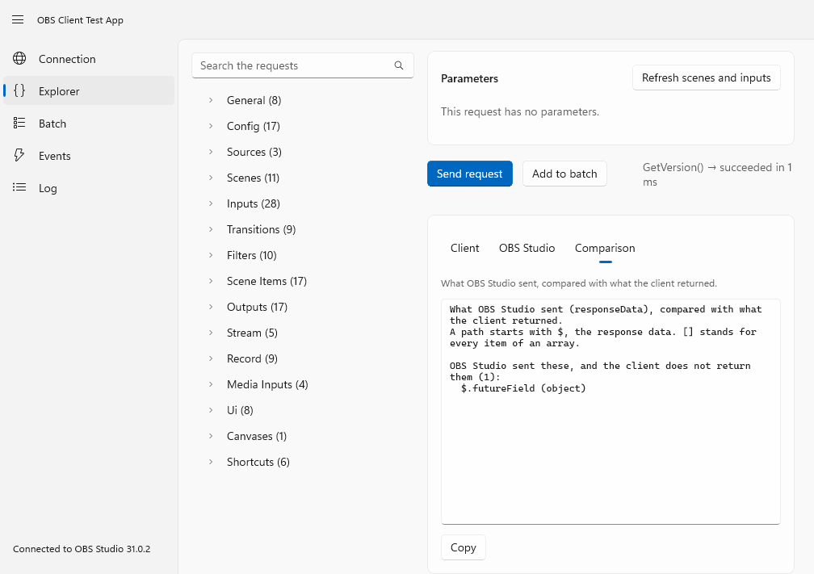
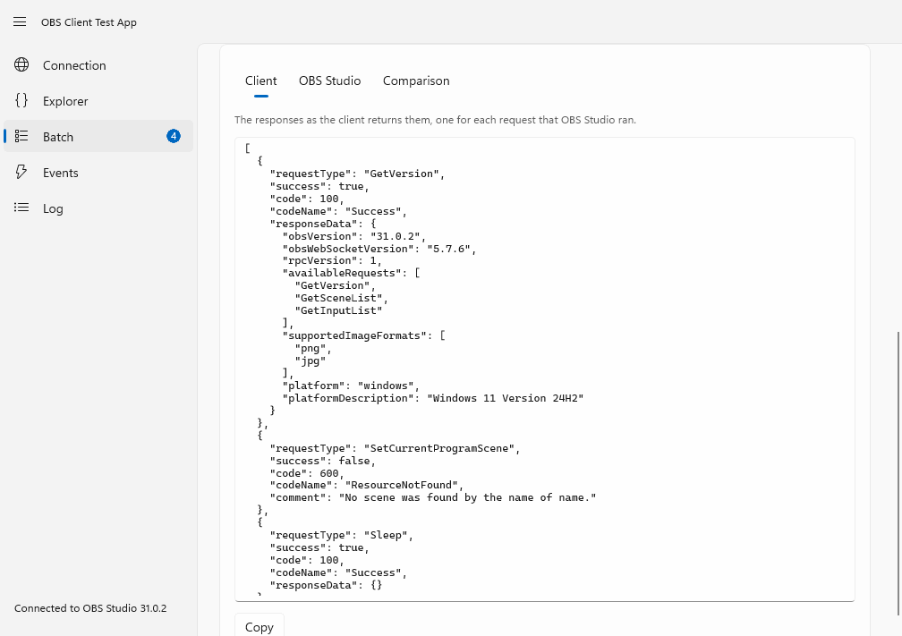
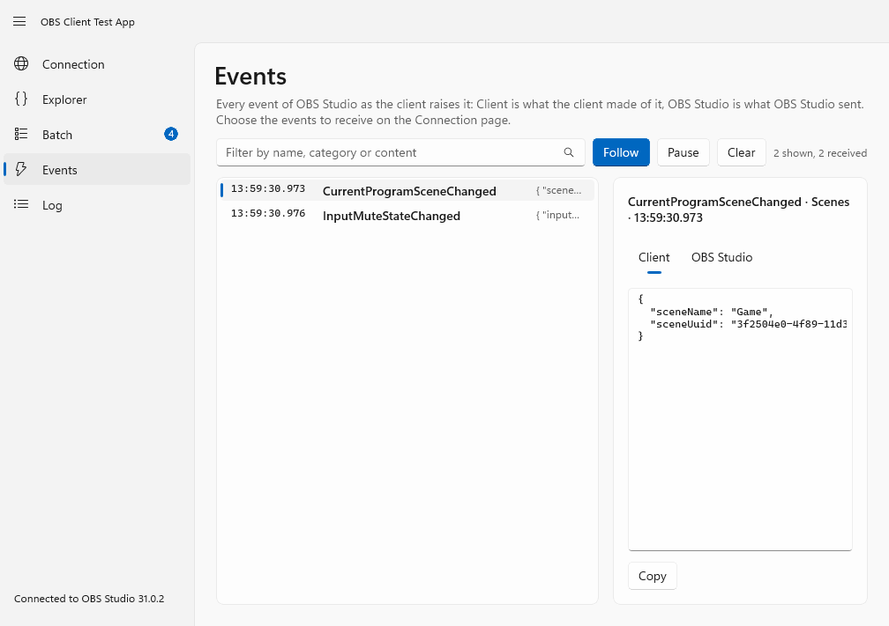

# The test app

`OBSClient.TestApp` is a Windows application (WinUI 3, Fluent 2) to **try every request and event of the library by hand**, against your
own OBS Studio. It is made for human testing and trials: it lets you see what a request does and what the client makes of the answer
before you write any code. It is not part of the NuGet package.



*The screenshots on this page come from the app's automated smoke test, which runs against a simulated OBS Studio.*

## Get it

Every build of the `main` branch publishes the app as the artifact **`OBSClient.TestApp-win-x64`** of the
[Build and Test workflow](https://github.com/tinodo/obsclient/actions/workflows/build.yml): open the newest successful run on `main`, and
download the artifact (GitHub asks you to sign in to download artifacts, and keeps them for two weeks). Unzip it and start
`OBSClient.TestApp.exe`. The app is self-contained, so nothing else has to be installed. It is built for Windows 10 version 1809 and later,
and the artifact is for x64.

> [!NOTE]
> The app is not code signed, so Windows may warn that the publisher is unknown.

To build and run it from the source you need Windows and the .NET 10 SDK:

```shell
dotnet run --project OBSClient.TestApp -p:Platform=x64
```

## The pages

| Page | What it does |
| --- | --- |
| **Connection** | Host, port, password and the events to receive. A Reidentify applies a change while connected. Shows the version of OBS Studio and the traffic of the session. |
| **Explorer** | Every request of the protocol (and the hand-written ones and the shortcuts), grouped like the protocol documentation, with an editor for each parameter that suits its type: the scenes and inputs of your OBS Studio are offered, by name or by UUID. The result is shown three ways, see below. A request can also be put in the batch. |
| **Batch** | The requests that you put in the batch, in the order in which they will run. Choose how OBS Studio runs them (serial in real time, serial per frame, parallel) and whether it stops at the first failure, send the batch, and see the response of each request the same three ways. |
| **Events** | Every event as the client raises it, with the message of OBS Studio next to it. |
| **Log** | Every message that went over the wire, and everything else the client reports. Export it as JSON lines, and export the **observed shapes**: which members were seen in each response and event, and what kind of value each was. |

## Three views of every result



- **Client** is what the client returned: the typed response, as JSON.
- **OBS Studio** is the message that OBS Studio sent.
- **Comparison** lists what OBS Studio sent and the client does not return (a nested member that the client does not know, for example),
  what the client returns and OBS Studio did not send, and members that are another kind of value.

If you find a difference, that is a gap in the library: please [open an issue](https://github.com/tinodo/obsclient/issues) with the
member and the request.



## Good to know

- What the app shows is a sample: a member that was not seen may still exist, and a feature that depends on your hardware (the virtual
  camera, the replay buffer, a streaming service) only answers when your OBS Studio has it.
- Exports go to `Documents\OBSClient Test App`. Passwords and stream keys are hidden in them unless you say otherwise, but check a file before
  you share it: it holds the names of your scenes and inputs.
- The requests and events of the app are generated from the protocol definition, like the library is, so a new request of a new
  protocol version shows up in the app by itself.
- The captures of a real OBS Studio that the library's tests use are made with a script, see
  [Contributing](https://github.com/tinodo/obsclient/blob/main/CONTRIBUTING.md#captures-of-a-real-obs-studio).
